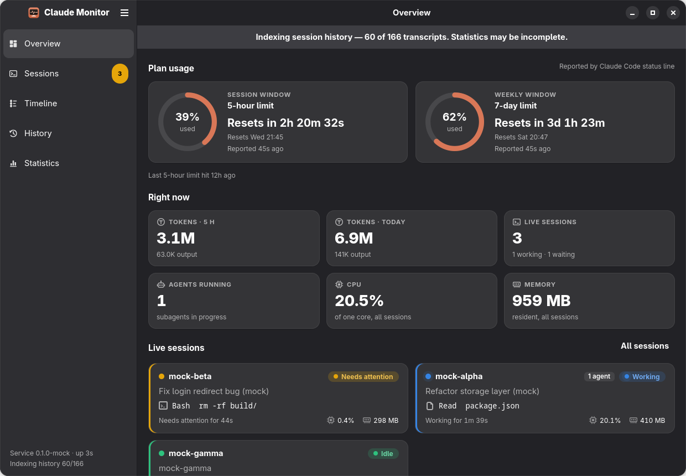
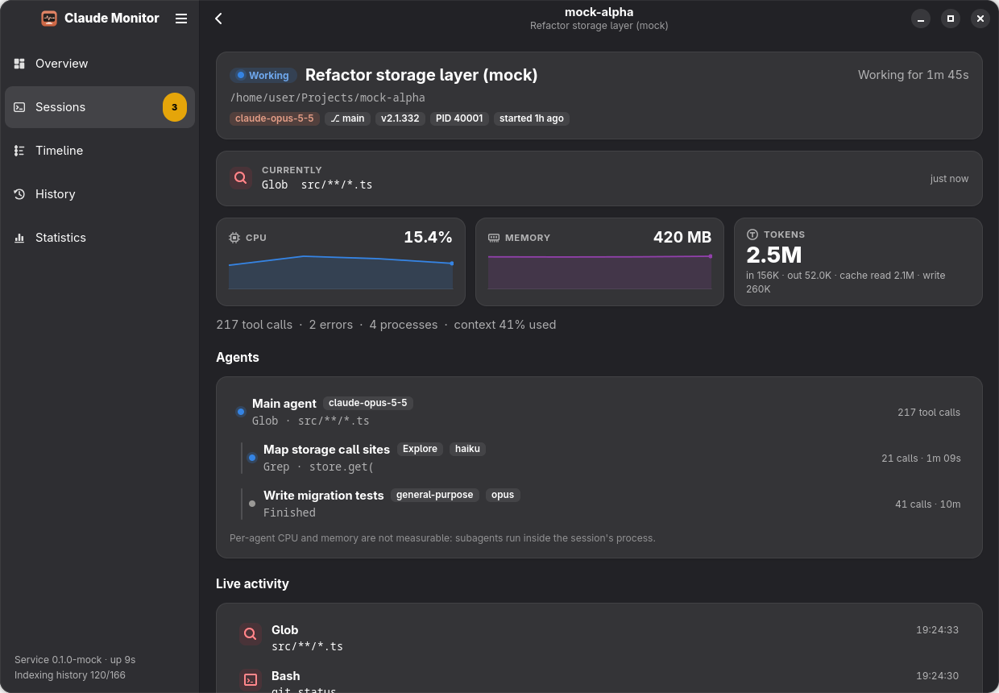

# Claude Monitor

Native GNOME monitoring for every Claude Code session on your machine — a
top-bar indicator, a full dashboard, desktop notifications and session
history. Local only: no network, no tokens, no root, and Claude Code's
configuration is never touched unless you opt in.



| Session detail | Statistics |
|---|---|
|  |  |


*Screenshots use mock data (`tools/mock_daemon.py`).*

## Components

| Component | What it is |
|---|---|
| `claude-monitord` | Background service (systemd user unit). Reads `~/.claude` read-only, keeps history in SQLite, exposes D-Bus. |
| `claude-monitor-dashboard` | GTK4 / libadwaita dashboard: overview, live sessions & agents, timeline, history, statistics, settings. |
| GNOME Shell extension | Top-bar indicator: session count, 5-hour usage, and a detail menu. |
| `claude-monitor` | CLI: `claude-monitor status`, `claude-monitor timeline`. |
| `claude-monitor-statusline` | *Optional* status-line tee that lets the monitor see plan-limit percentages. |

## Install

```bash
./install.sh                    # daemon, dashboard, CLI, shell extension
./install.sh --with-statusline  # + plan usage limits (edits ~/.claude/settings.json, with backup)
```

On Wayland, log out and back in once after the first install so GNOME Shell
loads the extension. Uninstall with `./uninstall.sh` (`--purge` also deletes
history).

## Usage limits — what is and isn't available

The 5-hour and weekly percentages exist only inside Claude Code. With the
opt-in status-line tee, Claude Code hands them (plus context-window usage) to
a tiny local script that saves them for the monitor — no extra API calls, no
tokens. If you already have a status line, it is chained and keeps working;
uninstall restores it exactly. Without the tee the monitor shows exact token
counts from your transcripts and reset times when a limit is hit, and says
"unavailable" for percentages rather than guessing.

## Development

```bash
python3 -m claude_monitor.daemon -v       # run daemon from the source tree
python3 -m claude_monitor.dashboard       # run dashboard
python3 -m unittest discover -s tests -t .
```

See `docs/ARCHITECTURE.md` and the D-Bus contract in `docs/CONTRACT.md`.
