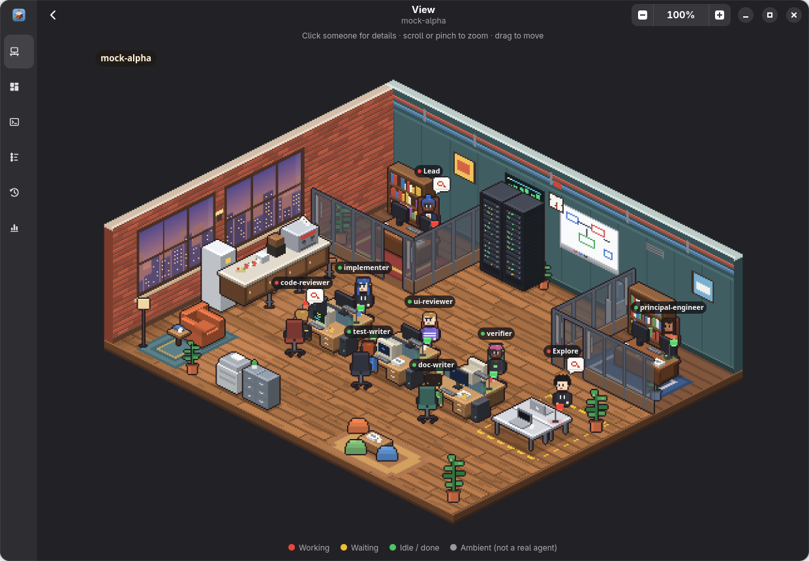
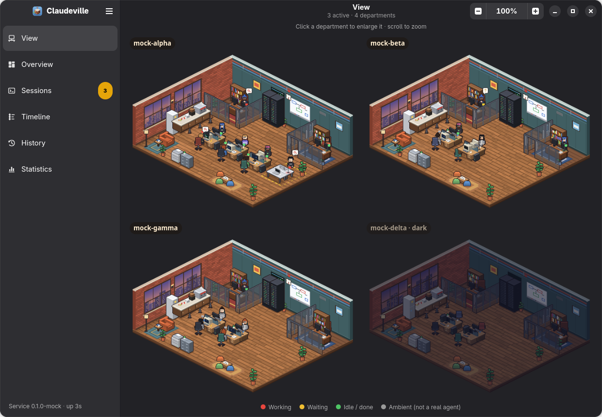
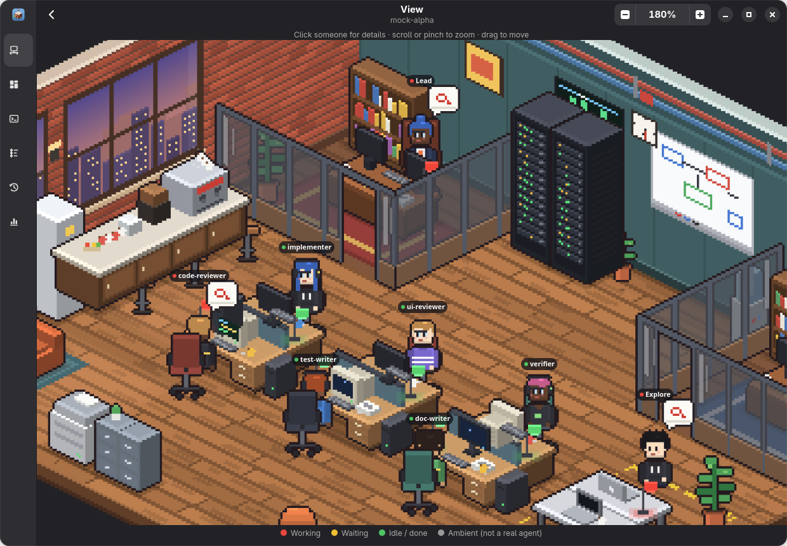
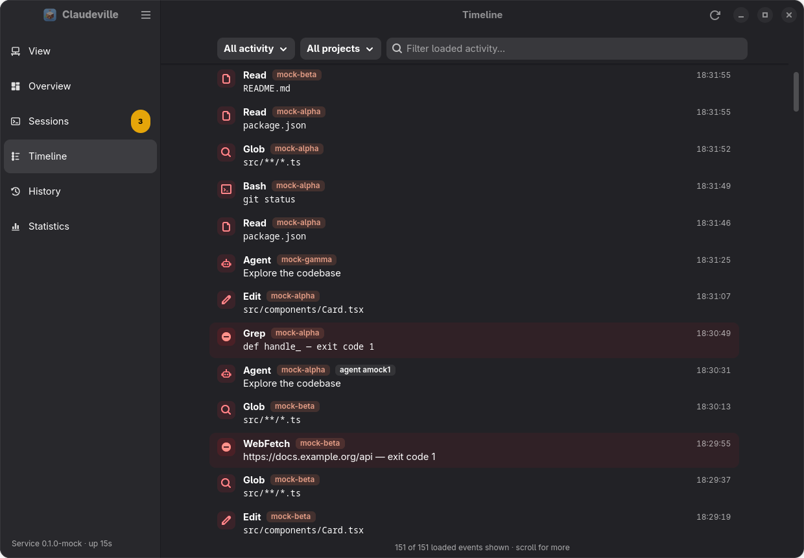
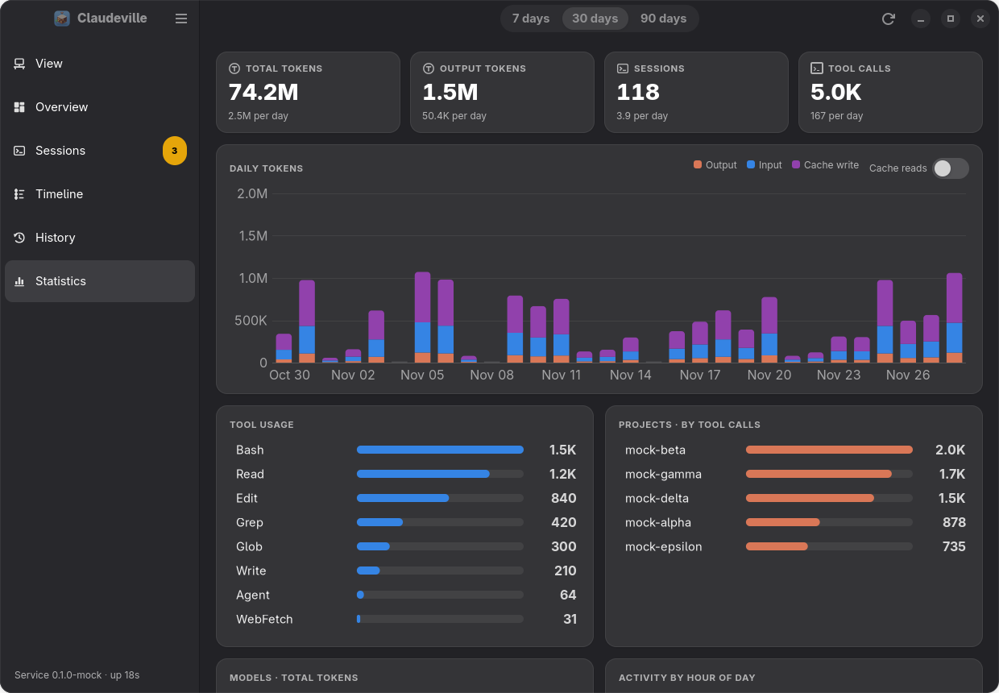
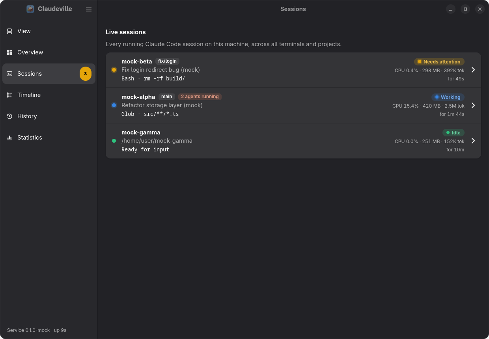
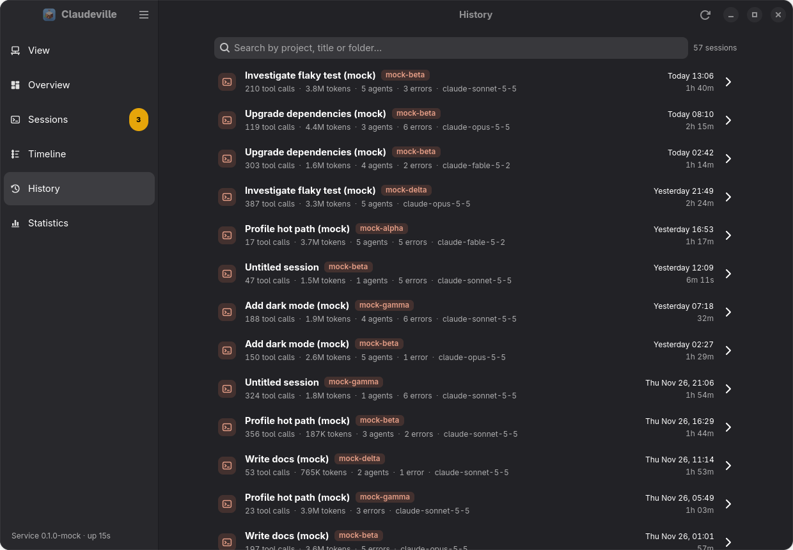
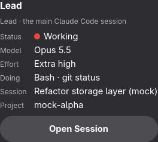

<p align="center">
  
</p>

<h1 align="center">Claudeville</h1>

<p align="center">
  <b>Watch your Claude Code sessions come alive as a pixel-art office.</b><br>
  A native GNOME app that monitors every Claude Code session on your machine:
  live status, subagents, tools, CPU and memory, plan usage, history and stats.<br>
  Local only: no network, no tokens, no root.
</p>

<p align="center">
  <a href="#install">Install</a> ·
  <a href="#features">Features</a> ·
  <a href="#screenshots">Screenshots</a> ·
  <a href="#privacy">Privacy</a> ·
  <a href="LICENSE">MIT License</a>
</p>



Every live Claude Code session becomes a department of the office. The session
is the **lead** in the glass-walled office; its subagents work at the desks.
The desk lamp shows what each one is doing: **red** working, **yellow** waiting
(for you, or for its subagents), **green** idle. A speech bubble shows the tool
someone is really using right now. Idle agents get up for coffee, visit the
whiteboard or chat with a colleague; whoever is called to work hurries back.

## Install

**One line** (installs the latest release for your user, no root needed):

```bash
curl -fsSL https://raw.githubusercontent.com/Aliyov/claudeville/main/install.sh | bash
```

Then open **Claudeville** from Activities. That's it.

Prefer to look before you run? Download a release (or `git clone`), then:

```bash
git clone https://github.com/Aliyov/claudeville.git
cd claudeville
./install.sh
```

### Requirements

- Linux with a systemd user session, and [Claude Code](https://claude.com/claude-code)
- Python 3.10+, GTK 4 and libadwaita 1.6+ with Python bindings. The installer
  checks these and tells you the exact command if something is missing:

| Distribution | Command |
|---|---|
| Fedora | `sudo dnf install python3-gobject gtk4 libadwaita` |
| Ubuntu / Debian | `sudo apt install python3-gi gir1.2-gtk-4.0 gir1.2-adw-1` |
| Arch | `sudo pacman -S python-gobject gtk4 libadwaita` |

- The optional top-bar indicator is a GNOME Shell extension for **GNOME 50**.
  On other desktops or versions the installer skips it; the app and the
  service work everywhere. After the first install, log out and back in once
  so GNOME Shell loads it.

### Options

```bash
./install.sh --with-statusline   # also show plan usage % (see below)
./install.sh --no-extension      # skip the top-bar indicator
./uninstall.sh                   # remove (keeps history); --purge deletes it too
```

Updating is the same command again; your history is kept.

## Features

- **Office View**: an animated pixel-art office per session. Click a department
  to enlarge it, scroll or pinch to zoom, drag to pan, click anyone for details
  (role, status, model, effort, current tool, task). Teams come from your
  Claude Code agent files (`.claude/agents/*.md`); the highest-ranked agent gets
  the private room, built-in agents work at temporary "contractor" desks, and
  big teams simply get a bigger office (tested with 50 agents).
- **Overview**: plan usage, token counters, live sessions, CPU and memory.
- **Sessions**: every live session with its subagents, current tool and a live
  activity feed.
- **Timeline and History**: everything that happened, searchable, with exact
  token counts from your transcripts.
- **Statistics**: tokens per day and model, tools, projects, busiest hours.
- **Notifications** when a session finishes, fails or needs your attention.
- **Top-bar indicator** (GNOME) and a small **CLI** (`claudeville status`).
- Light, cheap and polite: the background service uses well under 1 % CPU and
  ~40 MB of memory; the office animation costs about 1 % CPU and stops when
  hidden.

## Screenshots

| All departments | Zoomed in |
|---|---|
|  |  |

| Overview | Session detail |
|---|---|
|  |  |

| Timeline | Statistics |
|---|---|
|  |  |

| Sessions | History | Person details |
|---|---|---|
|  |  |  |

*Screenshots use the bundled mock data (`tools/mock_daemon.py`), not real projects.*

## Plan usage limits

The 5-hour and weekly percentages exist only inside Claude Code. With the
opt-in status-line tee (`--with-statusline`), Claude Code hands them (plus
context-window usage) to a tiny local script that saves them for Claudeville:
no extra API calls, no tokens. If you already have a status line it is
chained and keeps working, and uninstalling restores it exactly. Without the
tee, Claudeville shows exact token counts and reset times when a limit is hit,
and says "unavailable" for percentages rather than guessing.

## Privacy

- Claudeville only **reads** Claude Code's local files (`~/.claude`); the
  service runs with the home directory mounted read-only by systemd.
- Prompts and responses are never stored. It keeps tool names, short
  summaries (file name, first line of a command), timestamps and token counts
  in a local SQLite database (`~/.local/share/claudeville`), pruned after 180
  days.
- There is no network code at all. Nothing in `~/.claude` is changed unless
  you choose `--with-statusline` (and then with a backup).

## How it works

| Component | What it is |
|---|---|
| `claudevilled` | Background service (systemd user unit). Reads `~/.claude` read-only, keeps history in SQLite, exposes D-Bus. |
| `claudeville-dashboard` | GTK4 / libadwaita app: office View, overview, sessions & agents, timeline, history, statistics, settings. |
| GNOME Shell extension | Top-bar indicator: session count, 5-hour usage and a detail menu. |
| `claudeville` | CLI: `claudeville status`, `claudeville timeline`. |
| `claudeville-statusline` | *Optional* status-line tee for plan-limit percentages. |

Design notes: [`docs/ARCHITECTURE.md`](docs/ARCHITECTURE.md) · D-Bus contract:
[`docs/CONTRACT.md`](docs/CONTRACT.md).

## Development

```bash
python3 -m claudeville.daemon -v                 # run the service from the source tree
python3 -m claudeville.dashboard                 # run the app
python3 -m unittest discover -s tests -t .       # tests
python3 tools/mock_daemon.py --indexed &         # fake data for UI work (use a private bus:
                                                 #  dbus-run-session -- sh -c '...')
```

Claudeville is an independent project and is not affiliated with Anthropic.
"Claude" and "Claude Code" are trademarks of Anthropic.

## License

[MIT](LICENSE) © 2026 Aliyov
